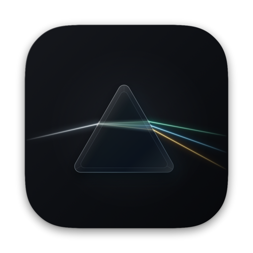

<div align="center">
  
  <h1> AppleLens</h1>
</div>

<p align="center">
  <strong>零 MitM、纯只读的 macOS 原生 Apple 智能观测、USB 真机日志诊断、分流预检探针 & 透明报告解码工作台</strong><br>
  适用于 macOS 14.0+（MenuBar 常驻菜单栏 + 独立 Workbench 工作台 + <code>applelens</code> CLI）
</p>

<p align="center">
  <strong>简体中文</strong> ·
  <a href="./README_EN.md">English</a> ·
  <a href="https://github.com/Kianuni/Erosion-CN">Erosion-CN</a> ·
  <a href="https://github.com/Kianuni/AppleFlow">AppleFlow</a> ·
  <a href="https://kianuni.github.io/Lokey-Audit/">Lokey 零联网输入法</a> ·
  <a href="https://github.com/Kianuni/WQGuard">WQGuard</a> ·
  <a href="https://github.com/Kianuni/Enkard">Enkard</a> ·
  <a href="https://github.com/Kianuni/Camlo">Camlo · 开幕</a>
</p>

<p align="center">
  
  
  
  <a href="./LICENSE"></a>
</p>

---

## 协同生态 · Enable · Route · Observe

**AppleLens** 与 **[Erosion-CN](https://github.com/Kianuni/Erosion-CN)**、**[AppleFlow](https://github.com/Kianuni/AppleFlow)** 共同组成面向 Apple Intelligence 的开源协同生态，打通「**设备准入 → 零 MitM 分流 → 观测与排障**」完整链路：

| 阶段 | 项目 | 核心定位 | 解决什么问题 |
| :--- | :--- | :--- | :--- |
| **1. 解锁与底层基线** | **[Erosion-CN](https://github.com/Kianuni/Erosion-CN)** | iOS / iPadOS 系统配置与 `MobileGestalt` 研究工具箱 | 在支持的系统版本上安全解锁国行（`CH/A`）Apple Intelligence、eSIM、FaceTime 音频，并提供防白苹果写入校验与双金库一键还原 |
| **2. 零 MitM 极简分流** | **[AppleFlow](https://github.com/Kianuni/AppleFlow)** | 零 HTTPS 解密的 Apple 智能、PCC 与中文 Siri 分流方案 + [在线配置体检台](https://kianuni.github.io/AppleFlow/) | 保证中文 Siri（`guzzoni.apple.com`）Real-IP 直连不报错，同时将盲签名令牌域、PCC 隐私中继与第三方 AI 扩展精准分流至支持 UDP/QUIC 的美区节点 |
| **3. 可观测性与排障解码** | **AppleLens** *(本项目)* | macOS 原生菜单栏雷达 + 工作台 + CLI 只读诊断套件 | 实时观测端侧 / Apple PCC / 外部大模型外连动态，直连 USB iPhone 翻译常见故障日志，实测 4 路出口与 QUIC/证书固定，并纯本地解码 `Apple_Intelligence_Report.json` |

```text
  [1. Erosion-CN] 设备端底层准入 ──▶ [2. AppleFlow] 零 MitM 精准分流 ──▶ [3. AppleLens] macOS 观测 · 探针 · 报告取证
```

---

## 核心功能与四大模块

AppleLens 提供 **MenuBarPopover** 菜单栏快捷面板、**Workbench** 桌面工作台（支持内置 **中文 / EN** 实时切换与 **本机 Mac / USB 连接 iPhone** 视角切换）以及 **`applelens` CLI**，核心能力由 `AppleLensCore` 四大引擎驱动：

### 1. 实时三态 AI 雷达 (`Radar`)
- **五态实时状态机**：在菜单栏与工作台即时区分当前 AI 计算流向（支持 Mac / USB iPhone 视角严格隔离）：
  - 🟢 **端侧本地推理 (`On-Device ANE`)**：融合 `TGOnDeviceInferenceProviderService`、`modelmanagerd`、`generativeexperiencesd`，实时捕捉**相册智能消除 (`Clean Up`)** 与相机控制**视觉智能 (`Visual Intelligence`)**。
  - 🔵 **Apple PCC 私有云 (`Apple Private Cloud Compute`)**：捕获 `privatecloudcomputed`、OHTTP/Attestation 信号、`server_diffusion` 及 PCC 相关套接字连接。
  - 🟠 **第三方外部大模型 (`External LLM`)**：毫秒级识别桌面端外连大模型的进程（App 图标、PID、Bundle ID、Fake-IP/Real-IP），并在 USB iPhone 模式下捕捉 `Claude`、`ChatGPT`（含 Siri / 视觉智能扩展）、`Gemini`、`豆包 (Grace)` 等 iOS 原生 AI 会话与 `installation_proxy` 动态发现。
  - 🟣 **多端并发 (`Hybrid`)** / ⚪ **静默待命 (`Idle`)**。
- **16 家海内外大模型全覆盖 (`LLMEndpointCatalog`)**：内置 `Apple PCC`、`OpenAI / ChatGPT`、`Anthropic / Claude`、`Google Gemini`、`OpenRouter`、`xAI / Grok`、`Groq`、`Perplexity`、`Mistral AI`、`DeepSeek 深度求索`、`豆包 / 火山方舟`、`通义千问 / 百炼`、`Kimi / 月之暗面`、`智谱清言 / BigModel`、`MiniMax`、`硅基流动 SiliconFlow`。
- **陌生进程首次外连提醒与信任管理 (`FirstSeenProcessTracker`)**：当未受信任的进程首次外连外部大模型时触发桌面横幅与系统通知（`.app` 束内自动授权），支持一键「信任 / 取消信任」与**已信任进程管理 (`Trusted Processes`)** 列表持久化管理。
- **自适应休眠省电与桌面便捷控制**：系统休眠或空闲退后台时自动降低轮询频率以节省电量（唤醒或打开窗口瞬间恢复）；桌面端还支持**关闭主窗口隐藏程序坞图标**、**开机自启动**以及**手动检查更新**。

### 2. 统一日志与 USB 真机故障翻译官 (`Diagnostics`)
- **双端独立只读日志流**：Mac 与 USB iPhone 各自拥有独立的实时监听开关（切换设备互不打断），断线后自动无感重连，并支持一键**复制脱敏诊断单**（自动隐藏公网 IP、UDID 与个人设备名后再导出 Markdown）：
  - **本机 Mac**：调用 `/usr/bin/log stream --style ndjson` 实时过滤 AI / Siri / PCC 进程与子系统，并支持一键回溯最近 15 分钟历史日志（`log show --last 15m`）。
  - **USB 连接 iPhone**：直接读取通过数据线连接的 iOS 设备状态（型号、iOS 版本、`RegionInfo`、配对信任状态）、动态识别已装 AI 客户端并接收过滤后的 `syslog_relay` 实时日志。
  - **离线拖拽导入**：直接将 `.log` / `.txt` / `.ips` 日志文件拖入窗口或文件选择器即可批量翻译，并内置「**模拟 6 大故障 / Simulate 6 Faults**」一键预览。
- **8 类典型故障 / 资产状态一键翻译 (`DiagnosticTranslator`)**：

| 诊断代码 | 触发特征 | 一句话解释与修复指引 |
| :--- | :--- | :--- |
| `PCC_32033_BLIND_TOKEN_LEAK` | `Code=32033` / `issuer.apple.com` 403/失败 | 盲签名令牌域漏走 `Apple_All` 直连，提供一键复制 `AppleFlow` 置顶规则 + 提醒冷重启清内存缓存 |
| `PCC_QUIC_UDP443_BLOCKED` | `QUIC-BLOCK` / `apple-relay` UDP 超时 | PCC OHTTP 通道所需的 UDP 443 (QUIC) 被节点或规则拦截，指引切换支持 UDP 的美区节点 |
| `PCC_1009_LOCAL_COOLDOWN` | `Code=1009` 且含 `retry-after` | `privatecloudcomputed` 内存已缓存冷却倒计时，修好规则后必须**关机重启设备一次**清缓存 |
| `PCC_1009_SERVER_QUOTA` | `Code=1009` 且不含 `retry-after` | 苹果服务端令牌配额限流（高频重试或共享机场节点抢占），建议停止重试等待数小时恢复 |
| `IOS27_3_CH_POLICY_LOCK` | `no CN region policy on a CH region code device` | iOS 27.3 beta+ 本地直读主板只读 `SysCfg` 拦截，警告**切勿注入 `slot=-1` 键**，指引检查兼容性 |
| `SIRI_GUZZONI_PROXY_MISROUTE` | `guzzoni.apple.com` / `siri.apple.com` 走代理或 `198.18.*` | 中文 Siri 核心网关被代理或 Fake-IP 误伤，提供一键复制 `skip-proxy` + `always-real-ip` + `DIRECT` 规则 |
| `GESTALT_SLOT_266_ABORT` | `Personal Translator` / `#266` / `ModelCatalog` 熔断 | 原生 AI 机型 `#266` 槽位基线异常导致 0ms 熔断，指引前往 `Erosion-CN v0.9.1+` 一键配齐 |
| `UAF_MODEL_ASSET_STATUS` | `UnifiedAssetFramework` 百分比 / 字节比 / `ADAssetManager` | 实时解析端侧模型下载进度条（`progressFraction`）与 `ASR` / `NLRouter` / `IntelligenceFlow (IF)` 就绪度 |

### 3. 四路预检探针与反 MitM 检测 (`Probe`)
- **4 条分流出口并发实测 (`ExitRegionLaneResult`)**：通过 `cdn-cgi/trace` 实时核验实际出口国家/地区与机房代码（支持 IP 隐私打码/明文切换）：
  1. `DIRECT` 国内直连基准（`www.visa.cn` / `www.cloudflare-cn.com`）——验证未误开全局代理，中文 Siri 安全；
  2. `PROXY` 默认海外代理基准（`1.1.1.1`）；
  3. Siri ChatGPT / OpenAI 实际出口（`chatgpt.com` / `platform.openai.com`）；
  4. Claude / PCC 中继边缘实际出口（`claude.ai` / `cp4.cloudflare.com`）。
- **Siri Real-IP 与系统代理例外审计 (`auditSiriDNSAndProxy`)**：检查 `guzzoni.apple.com`、`siri.apple.com` 是否被污染为 `198.18.0.0/15` Fake-IP，以及系统代理例外列表是否已纳入 `guzzoni.apple.com`。
- **原生 UDP 443 / QUIC (`h3`) 握手测试 (`probeQUICConnectivity`)**：并发直连 `cp4.cloudflare.com:443` 与 `apple-relay.fastly-edge.com:443`，精准甄别节点是否丢弃 UDP 或触发 `QUIC-BLOCK`。
- **9 端点 TLS 证书防劫持校验 (`probeAllEndpointsWithTLS`)**：覆盖 `guzzoni.apple.com`、`gspe1-ssl.ls.apple.com`、`api.smoot.apple.com`、`inference.issuer.apple.com`、`mask-api.icloud.com`、`ropes.apple.com`、`apple-relay.cloudflare.com`、`apple-relay.fastly-edge.com`、`lens.google.com`，捕获实时证书链并高亮标红代理 MitM 根证书（Surge / Proxyman / Charles / mitmproxy / Clash 等）。
- **自定义代理端口测试与一键脱敏报告导出**：支持按 `HTTP` / `SOCKS5`（如 `127.0.0.1:6152` 或 CLI `--proxy`）定向实测代理通道与海外端点（同时保持 `DIRECT` 直连基准不受干扰），并支持一键复制脱敏 Markdown 体检报告（GUI 按钮或 CLI `--markdown`）。

### 4. Apple 智能透明报告解读 (`ReportLens`)
- 支持拖放、一键直达系统设置导出指引、`~/Downloads` 自动发现最新导出的 `*Intelligence*Report*.json` 报告，或打开任意 **`Apple_Intelligence_Report.json`**（内置演示样板含「退出样板」支持）：
  1. **人话全局审计结论 (`ReportInsightEngine`) & 顶层关联**：自动关联顶层 `privateCloudComputeRequests` 与 `modelRequests`，识别真实功能（如 `VisualGeneration.PhotosEdit.Infill.1p` → 相册高质量消除）与隐私边界，并解释视觉扩散任务 `Prompt = 0` 的原因。
  2. **AFM 控制符提示词与工具调用切片 (`sliceAFMPrompt`)**：自动拆解 `<ctrl99>system / developer / thought / user / tool / model<ctrl100>` 区块，提取 **`Silent thinking token budget`**（`silentTokenBudget`）与 `AppIntents` / JSON 工具调用及返回预览；兼容 Unix 1970 与 Apple 2001 (`CFAbsoluteTime`) 双纪元时间戳。
  3. **云端节点与证书详情核验 (`CloudAttestationInspector`)**：直观展示云端节点角色（`TIE` 接入代理 vs 推理计算节点）、证书链与有效期核验状态、`SEP` / `APTicket` (`IM4M`) / `ATLog` 摘要、以及每张证书的颁发者、主题、有效期和算法信息。
  4. **`SealedHashLedger` 与原始 JSON**：提取并格式化加密封存槽位内的 `darwin-init` `SecureConfig` JSON（如 `release_train`、`environment`、`network_egress`）及关联原始 JSON。

---

## 技术实现特点（零 MitM · 纯只读 · 零第三方依赖）

- **Pure Swift 原生构建 (`Package.swift`)**：全工程纯 Swift 实现，仅链接 macOS 系统原生框架（`Darwin` / `Security` / `CryptoKit` / `Network` / `SystemConfiguration` / `ServiceManagement` / `SwiftUI` / `AppKit` / `UserNotifications`），不引入任何第三方 SwiftPM 依赖。
- **Fake-IP `198.18.0.0/15` + 真实 IP 精准归因**：
  - 使用 Darwin `libproc` 无子进程直接扫描本机活跃 TCP（`ESTABLISHED` / `SYN_SENT`）与已连接 UDP `:443` 套接字（按需解析有匹配外连的进程路径以节省空闲系统开销），并感知本地 HTTP/HTTPS/SOCKS 代理端口。
  - 将子进程与 Helper 可执行文件（例如 `/Applications/Antigravity.app/Contents/Resources/bin/language_server`）沿路径回溯折叠至最外层 `.app` 束，还原真实应用名称、Bundle ID 与图标，并自动过滤代理客户端自身（Surge、Mihomo、Clash、Stash、Loon、Shadowrocket 等）。
  - 针对 `198.18.0.0/15` Fake-IP（`198.18.x.x` / `198.19.x.x`）直接精确命中；针对共享 Cloudflare Anycast IP（`104.16.0.0/12`、`172.64.0.0/13`、`162.159.0.0/16`、`188.114.0.0/16`）、Google 前端及 Apple PCC 域启用已知客户端/守护进程门控，防止普通浏览器流量误报。
- **零依赖直连 USB iPhone (`MobileDevice.framework`)**：
  - 动态加载 macOS 系统内置私有通道安全接收真机 `com.apple.syslog_relay` 实时日志与已装 AI 应用列表。
  - **彻底免装 `libimobiledevice`、`idevicesyslog`、`pymobiledevice3` 或 Homebrew**，全程无需 `sudo`。
- **零根证书 TLS + 原生 QUIC (`h3`) 双通道探针**：
  - 无需安装任何本地 MitM CA 即可检查服务端真实证书链，并直接发起真实 UDP 443 HTTP/3 握手检测节点 UDP 通畅度。
- **免关闭 SIP 离线报告解析**：
  - 苹果官方命令行 `pccvre` 在未关闭 SIP 的零售版 macOS 上受限；`AppleLens` 内置纯 Swift 报告解析器，在开启完整 SIP 的日常 Mac 上即可直接查看报告完整细节。

---

## 安装与构建

### 方式一：普通用户免编译安装（推荐）

无需安装 Xcode 或 Swift 工具链，直接获取通用二进制安装包（支持 Apple Silicon M 系列与 Intel Mac）：

- **Homebrew Cask 一键安装（同时装配 App 与 `applelens` CLI）**：
  ```bash
  brew tap kianuni/applelens https://github.com/Kianuni/AppleLens
  brew install --cask applelens
  ```
- **`.dmg` 拖拽镜像**：前往 **[GitHub Releases](https://github.com/Kianuni/AppleLens/releases/latest)** 下载 `AppleLens-v*-universal.dmg`，双击打开并将 `AppleLens.app` 拖入「应用程序（Applications）」。
- **`.pkg` 向导安装包**：从 **[GitHub Releases](https://github.com/Kianuni/AppleLens/releases/latest)** 下载 `AppleLens-v*-installer.pkg`，双击下一步即可同时安装 `/Applications/AppleLens.app` 与 `/usr/local/bin/applelens` CLI。
- **一键无弹窗安装脚本（自动 SHA-256 校验）**：
  ```bash
  bash <(curl -fsSL https://raw.githubusercontent.com/Kianuni/AppleLens/main/scripts/install.sh)
  ```
  > `scripts/install.sh` 从 GitHub Releases 拉取安装包时会自动下载同版本的 `SHA256SUMS.txt` 并校验 `SHA-256` 摘要；若校验文件缺失、未列出对应压缩包或摘要不匹配，将在解压（`ditto`）和移除隔离属性（`xattr -cr`）之前中止安装（本地打包产物可使用 `./scripts/install.sh --local`）。
- **首次打开说明（Gatekeeper）**：若直接通过浏览器下载未公证的 Ad-hoc 签名版本并遇到“无法验证开发者”提示，可在终端执行一行放行命令或前往「系统设置 → 隐私与安全性」点击「仍要打开」：
  ```bash
  xattr -cr /Applications/AppleLens.app
  ```

### 方式二：开发者源码打包（`.app` / `.dmg` / `.pkg` / `.zip`）

- **环境要求**：macOS 14.0 (Sonoma)+，Swift 6.0+（Xcode 16+ 或 Command Line Tools）

```bash
git clone https://github.com/Kianuni/AppleLens.git
cd AppleLens
chmod +x scripts/build_app.sh scripts/package_release.sh scripts/install.sh

# 仅构建本地 .app 与 CLI
./scripts/build_app.sh

# 或一键打包通用架构 .dmg / .pkg / .zip 与 SHA256SUMS.txt
./scripts/package_release.sh
```

脚本将自动完成 Release 编译、纯 Swift `AppKit`/`CoreGraphics` 应用图标生成（`AppIcon.icns`）、`Info.plist`（含 `.json` 报告文档关联）装配、代码签名及标准安装包打包，产物位于：
- **桌面应用**：`dist/AppleLens.app`（内置命令行 `/Applications/AppleLens.app/Contents/MacOS/applelens-cli`，支持直接将 `.json` 报告或 `.log`/`.txt`/`.ips` 日志拖入工作台窗口）
- **分发安装包**：`dist/AppleLens.dmg`、`dist/AppleLens-v*-universal.dmg`、`dist/AppleLens-v*-installer.pkg`、`dist/AppleLens-v*-macos-universal.zip` 与 `dist/SHA256SUMS.txt`
- **命令行工具**：`dist/applelens`（可软链至 `/usr/local/bin/applelens`）

### 方式三：CLI 命令行速查

也可直接通过 `swift run applelens` 或打包后的 `./dist/applelens` 运行：

```bash
# 1. 立即执行一次四路出口 + Siri DNS + QUIC UDP 443 + TLS 防 MitM 探针（支持自定义代理与脱敏 Markdown）
applelens probe
applelens probe --proxy 127.0.0.1:6152
applelens probe --proxy socks5://127.0.0.1:1080 --markdown
applelens probe --json

# 2. 执行一次三态 AI 雷达快照（域名/Fake-IP 映射 + 活跃套接字 + 近 2 分钟统一日志融合）
applelens radar --once
applelens radar --once --json

# 3. 解码 Apple_Intelligence_Report.json（或使用内置真实结构样本快速体验）
applelens report --demo
applelens report ~/Desktop/Apple_Intelligence_Report.json --json

# 4. 翻译近 15 分钟本机 AI/PCC 统一日志故障（或查看内置 6 大经典故障演示）
applelens diagnose --last-15m
applelens diagnose --demo

# 5. 查看版本与中英双语帮助
applelens --version
applelens --help
```

### 运行单元测试

```bash
swift test --parallel
```

---

## 隐私与安全承诺

- **100% 本地只读**：不上传任何本机进程列表、IP 地址、系统日志或透明报告文件，无任何遥测、统计或暗桩代码。
- **零 MitM 原则**：永远不生成、不安装、不请求信任任何本地 MitM CA 证书，不触碰浏览器或系统私有通讯负载。

---

## 🛠️ 同作者开源作品矩阵 (More by Kianuni)

除上述协同工具链外，欢迎搭配使用 Kianuni 旗下的其他苹果生态安全、隐私与个性化开源工具：

| 项目 | 适用平台 | 核心定位与简介 |
| :--- | :--- | :--- |
| **[Erosion-CN](https://github.com/Kianuni/Erosion-CN)** | `iOS / iPadOS` | 系统配置与 `MobileGestalt` 研究工具箱（中英双语防白苹果安全加固版，支持国行 Apple Intelligence / eSIM / FaceTime 音频准入与双金库一键还原） |
| **[AppleFlow](https://github.com/Kianuni/AppleFlow)** | `Surge / Mihomo / Loon / Stash / Sing-box / QX` | 零 MitM 的 Apple 智能、PCC 隐私云计算与中文 Siri 极简分流规则集 + **[在线配置体检台](https://kianuni.github.io/AppleFlow/)** |
| **[Lokey](https://kianuni.github.io/Lokey-Audit/)** | `iOS / iPadOS` | 1:1 复刻 iOS 26 液态玻璃原生手感的纯离线全拼/双拼输入法；搭载端侧「落墨」引擎与只读 `mmap` 词库扩展，源码级物理零联网（[TestFlight](https://testflight.apple.com/join/Bx9gxXTN) · [源码审计](https://github.com/Kianuni/Lokey-Audit) · [55.3 万词白霜包](https://github.com/Kianuni/lokey-frost-pack)） |
| **[WQGuard](https://github.com/Kianuni/WQGuard)** | `iOS / macOS CLI` | 面向 iOS 26.2+/27.x 的 100% 只读开源沙盒越权检测、侧载 IPA 静态审查与固件 CVE 防护工具（附 5 大代理客户端防漏洞护盾订阅） |
| **[Enkard](https://github.com/Kianuni/Enkard)** | `iOS` | 纯离线、零云同步、绑定 Apple Secure Enclave 硬件安全芯片的 iPhone 银行级加密卡包 |
| **[Camlo · 开幕](https://github.com/Kianuni/Camlo)** | `iOS / iPadOS 26–27` | 让 iPhone 锁屏活起来：免电脑、免越狱一键应用滑动解锁变身、裸眼 3D 视差与动态锁屏壁纸（内置云端馆藏画廊） |

---

## 开源许可 (License)

本项目基于 **[MIT License](./LICENSE)** 开源。欢迎与 **[Erosion-CN](https://github.com/Kianuni/Erosion-CN)**、**[AppleFlow](https://github.com/Kianuni/AppleFlow)**、**[Lokey](https://kianuni.github.io/Lokey-Audit/)**、**[WQGuard](https://github.com/Kianuni/WQGuard)**、**[Enkard](https://github.com/Kianuni/Enkard)** 及 **[Camlo · 开幕](https://github.com/Kianuni/Camlo)** 搭配使用与自由贡献。
