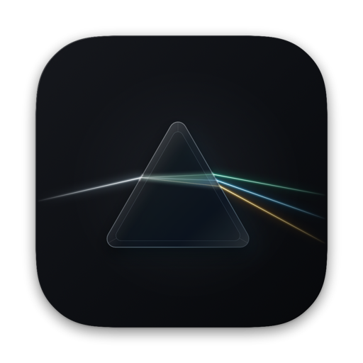

<div align="center">
  
  <h1> AppleLens</h1>
</div>

<p align="center">
  <strong>Zero-MitM, Read-Only Native macOS Suite for Apple Intelligence Observability, USB iPhone Diagnostics, Routing Pre-Flight Probes &amp; Transparency Report Decoding</strong><br>
  Built for macOS 14.0+ (MenuBar Extra + Workbench Window + <code>applelens</code> CLI)
</p>

<p align="center">
  <a href="./README.md">简体中文</a> ·
  <strong>English</strong> ·
  <a href="https://github.com/Kianuni/Erosion-CN">Erosion-CN</a> ·
  <a href="https://github.com/Kianuni/AppleFlow">AppleFlow</a> ·
  <a href="https://kianuni.github.io/Lokey-Audit/">Lokey</a> ·
  <a href="https://github.com/Kianuni/WQGuard">WQGuard</a> ·
  <a href="https://github.com/Kianuni/Enkard">Enkard</a> ·
  <a href="https://github.com/Kianuni/Camlo">Camlo</a>
</p>

<p align="center">
  
  
  
  <a href="./LICENSE"></a>
</p>

---

## Ecosystem · Enable · Route · Observe

**AppleLens** pairs with **[Erosion-CN](https://github.com/Kianuni/Erosion-CN)** and **[AppleFlow](https://github.com/Kianuni/AppleFlow)** as the observability and diagnostics layer of our open-source Apple Intelligence ecosystem — covering **device enablement**, **zero-MitM split routing**, and **real-time inspection**:

| Stage | Project | Role | What It Solves |
| :--- | :--- | :--- | :--- |
| **1. Unlock & Baseline** | **[Erosion-CN](https://github.com/Kianuni/Erosion-CN)** | iOS / iPadOS system customization &amp; bootloop-hardened `MobileGestalt` toolkit | Safely enables Apple Intelligence, eSIM, and FaceTime Audio on supported hardware/builds (`CH/A`), backed by in-place verification and dual-vault factory restore |
| **2. Zero-MitM Routing** | **[AppleFlow](https://github.com/Kianuni/AppleFlow)** | Minimal zero-MitM rulesets + [Interactive Web Config Doctor](https://kianuni.github.io/AppleFlow/) | Keeps Mandarin Siri (`guzzoni.apple.com`) on real-IP `DIRECT` while steering blind-signing token issuers, PCC relays, and AI extensions cleanly to UDP-enabled US exit nodes |
| **3. Observability &amp; Forensics** | **AppleLens** *(This Repo)* | Native macOS MenuBar Radar + Workbench + CLI read-only diagnostics suite | Monitors On-Device / Apple PCC / External LLM traffic live, bridges USB iPhone logs with zero third-party tools, probes 4 exit lanes + QUIC + TLS pinning, and decodes `Apple_Intelligence_Report.json` offline |

```text
  [1. Erosion-CN] Device Enablement ──▶ [2. AppleFlow] Zero-MitM Routing ──▶ [3. AppleLens] macOS Radar · Probe · Report Lens
```

---

## Architecture &amp; 4 Core Modules

AppleLens ships as a native SwiftUI **MenuBar Extra**, a full **Workbench Window** (with live **中文 / EN** switching and **This Mac / Connected iPhone** device mode toggle), and a standalone **`applelens` CLI**, all powered by four core engines inside `AppleLensCore`:

### 1. Tri-State AI Radar (`Radar`)
- **Live 5-State Telemetry**: Instant visibility in your menu bar and workbench (strictly isolated between This Mac and USB iPhone):
  - 🟢 **On-Device (`On-Device ANE`)**: Correlates unified log inference signals from `TGOnDeviceInferenceProviderService`, `modelmanagerd`, and `generativeexperiencesd`, plus live **Photos Clean Up** and Camera Control **Visual Intelligence**.
  - 🔵 **Apple PCC (`Apple Private Cloud Compute`)**: Detects `privatecloudcomputed` OHTTP/attestation activity, `server_diffusion` tasks, and PCC relay connections.
  - 🟠 **External LLM (`External LLM`)**: Identifies desktop/CLI apps talking to third-party LLM APIs with real `.app` icons, PIDs, bundle IDs, matched domains, and Fake-IP/Real-IP badges, plus USB iPhone sessions (`Claude`, `ChatGPT` including Siri / Visual Intelligence extensions, `Gemini`, `Doubao`, and dynamic `installation_proxy` discovery).
  - 🟣 **Hybrid (`Hybrid`)** / ⚪ **Idle (`Idle`)**.
- **16 Catalogued Providers (`LLMEndpointCatalog`)**: `Apple PCC`, `OpenAI / ChatGPT`, `Anthropic / Claude`, `Google Gemini`, `OpenRouter`, `xAI / Grok`, `Groq`, `Perplexity`, `Mistral AI`, `DeepSeek`, `Doubao / Volcengine Ark`, `Qwen / DashScope`, `Kimi / Moonshot`, `Zhipu / BigModel`, `MiniMax`, and `SiliconFlow`.
- **First-Seen Process Guard & Trusted Process Manager (`FirstSeenProcessTracker`)**: Raises an in-app banner (and native `UNUserNotificationCenter` alert when running inside `.app`) the first time an untrusted process connects to an external LLM, with one-click persistent Trust / Untrust and a **Trusted Processes** management card.
- **Adaptive Power Saving &amp; Desktop Controls**: Automatically backs off polling when the UI is hidden and idle (resuming immediately on activity or window open) and pauses during macOS system sleep; Workbench also supports **Hide Dock When Closed**, **Launch at Login**, and manual **Check for Updates**.

### 2. Unified Log &amp; USB iPhone Diagnostics (`Diagnostics`)
- **Independent Dual-Target Read-Only Ingestion**: Mac and USB iPhone streams track independent toggle state (switching devices never stops the other stream), auto-reconnect cleanly on USB resets, and export 1-click **Redacted Markdown Diagnostics** with public IPv4/IPv6, UDIDs, and personal device names scrubbed:
  - **This Mac**: Streams `/usr/bin/log stream --style ndjson` filtered to Apple Intelligence / Siri / PCC processes and subsystems, or scans the last 15 minutes via `log show --last 15m`.
  - **Connected iPhone (USB)**: Displays connected iOS device metadata (`ProductType`, `ProductVersion`, `RegionInfo`, pairing status), discovers installed AI apps dynamically, and streams filtered `syslog_relay` events over USB.
  - **Drag-and-Drop / Demo Mode**: Drop `.log`, `.txt`, or `.ips` files directly into the Workbench to translate offline logs, or click **Simulate 6 Faults** for an instant walkthrough.
- **8 Built-In Fault &amp; Asset Translators (`DiagnosticTranslator`)**:

| Diagnostic Code | Log Signature | Explanation &amp; Remediation |
| :--- | :--- | :--- |
| `PCC_32033_BLIND_TOKEN_LEAK` | `Code=32033` / `issuer.apple.com` errors | Blind-signing token endpoints fell through to `Apple_All -> DIRECT`; provides copyable `AppleFlow` top-priority rules + reboot reminder |
| `PCC_QUIC_UDP443_BLOCKED` | `QUIC-BLOCK` / `apple-relay` UDP timeouts | UDP 443 (`QUIC` / `OHTTP`) is dropped by your proxy node or blocked by a `QUIC-BLOCK` rule; points to live QUIC Probe verification |
| `PCC_1009_LOCAL_COOLDOWN` | `Code=1009` with `retry-after` | `privatecloudcomputed` cached a cooldown timer in RAM; reboot the device once after fixing proxy rules |
| `PCC_1009_SERVER_QUOTA` | `Code=1009` without `retry-after` | Server-side anonymous token rate limiting (rapid retries or congested shared exit IP); pause retries and switch to a clean US node |
| `IOS27_3_CH_POLICY_LOCK` | `no CN region policy on a CH region code device` | iOS 27.3 beta+ checks non-cached hardware `SysCfg` before any network call; warns against `slot=-1` writes and links to `Erosion-CN` compatibility guidance |
| `SIRI_GUZZONI_PROXY_MISROUTE` | `guzzoni.apple.com` / `siri.apple.com` proxy or `198.18.*` errors | Mandarin Siri gateway hijacked by proxy or Fake-IP; provides one-click copyable `skip-proxy` + `always-real-ip` + `DIRECT` snippet |
| `GESTALT_SLOT_266_ABORT` | `Personal Translator` / `#266` / `ModelCatalog` abort | Native AI slot `#266` mismatch causing 0ms local pre-flight abort; directs to `Erosion-CN v0.9.1+` 1-click baseline repair |
| `UAF_MODEL_ASSET_STATUS` | `UnifiedAssetFramework` `%` / byte ratio / `ADAssetManager` | Renders live download progress (`progressFraction`) and `ASR` / `NLRouter` / `IntelligenceFlow (IF)` readiness |

### 3. Four-Lane Pre-Flight Probe &amp; Anti-MitM Inspector (`Probe`)
- **4 Concurrent Exit Region Lanes (`ExitRegionLaneResult`)**: Probes `cdn-cgi/trace` across 4 routing lanes with toggleable IP masking (`RoutingProbeFormatter`):
  1. Domestic `DIRECT` baseline (`www.visa.cn` / `www.cloudflare-cn.com`) — confirms Global Proxy isn't breaking Mandarin Siri;
  2. Default `PROXY` exit (`1.1.1.1`);
  3. Siri ChatGPT / OpenAI actual exit (`chatgpt.com` / `platform.openai.com`);
  4. Claude / Cloudflare PCC relay exit (`claude.ai` / `cp4.cloudflare.com`).
- **Siri Real-IP &amp; System Proxy Audit (`auditSiriDNSAndProxy`)**: Flags `198.18.0.0/15` Fake-IP hijacks on `guzzoni.apple.com` / `siri.apple.com` and verifies `SCDynamicStoreCopyProxies` exceptions.
- **Native UDP 443 / QUIC (`h3`) Probe (`probeQUICConnectivity`)**: Performs live HTTP/3 QUIC handshakes to `cp4.cloudflare.com:443` and `apple-relay.fastly-edge.com:443`.
- **9-Endpoint TLS Certificate Anti-MitM Audit (`probeAllEndpointsWithTLS`)**: Inspects live certificate chains for `guzzoni.apple.com`, `gspe1-ssl.ls.apple.com`, `api.smoot.apple.com`, `inference.issuer.apple.com`, `mask-api.icloud.com`, `ropes.apple.com`, `apple-relay.cloudflare.com`, `apple-relay.fastly-edge.com`, and `lens.google.com`, highlighting proxy MitM CAs (`Surge`, `Proxyman`, `Charles`, `mitmproxy`, `Clash`, etc.) in red.
- **Custom Proxy Port Probing &amp; Redacted Markdown Export**: Probe non-DIRECT exit lanes and overseas TLS endpoints through an explicit `HTTP` or `SOCKS5` proxy port (via GUI Custom Proxy input or `applelens probe --proxy`) while keeping `DIRECT` baseline checks isolated, and export a 1-click redacted Markdown probe report (GUI button or `--markdown`).

### 4. Apple Intelligence Transparency Report Lens (`ReportLens`)
- Auto-discovers the newest `*Intelligence*Report*.json` in `~/Downloads`, or open/drop any **`Apple_Intelligence_Report.json`** with a 1-click System Settings export shortcut (or explore and exit the built-in interactive fixture):
  1. **Executive Plain-Language Audit (`ReportInsightEngine`) &amp; PCC Correlation**: Correlates top-level `privateCloudComputeRequests` with `modelRequests`, translates capability identifiers (e.g., `VisualGeneration.PhotosEdit.Infill.1p` → Photos Clean Up), summarizes privacy guarantees, and explains why visual diffusion tasks show 0 text prompts.
  2. **AFM Control-Token Slicer &amp; Tool Calls (`sliceAFMPrompt`)**: Splits `<ctrl99>system / developer / thought / user / tool / model<ctrl100>` prompt blocks, extracts **`Silent thinking token budget`** (`silentTokenBudget`), parses `AppIntents` / JSON tool calls + results, and normalizes dual-epoch timestamps (Unix 1970 and Apple 2001 `CFAbsoluteTime`).
  3. **Cloud Node &amp; Certificate Chain Inspector (`CloudAttestationInspector`)**: Displays cloud node roles (`TIE` proxy vs compute node), certificate validity &amp; chain check status, `SEP` / `APTicket` (`IM4M`) / `ATLog` digests, and per-certificate Subject, Issuer, validity dates, key algorithm, and SHA-256 fingerprint.
  4. **`SealedHashLedger` &amp; Raw JSON**: Pretty-prints sealed `darwin-init` `SecureConfig` JSON (`release_train`, `environment`, `network_egress`) alongside correlated raw request JSON.

---

## Technical Highlights (Zero-MitM · Read-Only · Zero External Dependencies)

- **Pure Swift Native Build (`Package.swift`)**: Pure Swift linked strictly against native Apple frameworks (`Darwin`, `Security`, `CryptoKit`, `Network`, `SystemConfiguration`, `ServiceManagement`, `SwiftUI`, `AppKit`, `UserNotifications`) with zero third-party SwiftPM dependencies.
- **Fake-IP `198.18.0.0/15` + Real-IP Attribution &amp; App Bundle Roll-Up**:
  - Uses Darwin `libproc` (`proc_listallpids`, `proc_pidinfo`, `proc_pidpath`, `PROC_PIDFDSOCKETINFO`) to inspect active TCP (`ESTABLISHED` / `SYN_SENT`) and connected UDP `:443` sockets with zero child-process spawning (lazily resolving paths only when matching sockets exist) combined with `SCDynamicStoreCopyProxies` proxy port detection.
  - Walks subprocess paths back to the outermost `.app` bundle (e.g., rolling `/Applications/Antigravity.app/Contents/Resources/bin/language_server` up to `Antigravity.app`), automatically excludes proxy clients (`Surge`, `Mihomo`, `Clash`, `Stash`, `Loon`, `Shadowrocket`), and gates shared Cloudflare Anycast (`104.16.0.0/12`, `172.64.0.0/13`, `162.159.0.0/16`, `188.114.0.0/16`) and Google frontends against known AI clients to prevent browser false positives.
- **Zero-Dependency USB `MobileDevice.framework` Bridge (`USBiPhoneLogBridge`)**:
  - Dynamically loads macOS's built-in `/System/Library/PrivateFrameworks/MobileDevice.framework/MobileDevice` (with `/Library/Apple/...` fallback) to read filtered `com.apple.syslog_relay` streams and installed AI app metadata over USB — **no `libimobiledevice`, `idevicesyslog`, `pymobiledevice3`, or `sudo` required**.
- **Root-CA-Free TLS + Native `NWProtocolQUIC` (`h3`) Verification**:
  - Inspects live server certificate chains without installing any root CA, while `NWProtocolQUIC.Options(alpn: ["h3"])` verifies genuine UDP 443 HTTP/3 reachability.
- **SIP-Safe Offline Report Decoder**:
  - Apple's official `pccvre` CLI is blocked on retail macOS unless SIP (`allow-research-guests`) is disabled. AppleLens includes a built-in pure-Swift decoder so `Apple_Intelligence_Report.json` bundles and certificate details inspect cleanly on full-SIP retail Macs.

---

## Installation &amp; Build

### Option 1: End-User Prebuilt Installers (No Xcode Required)

Ready-to-run macOS Universal binaries (`arm64` Apple Silicon + `x86_64` Intel) can be installed directly without any developer tools:

- **Homebrew Cask (Recommended — installs both `AppleLens.app` and the `applelens` CLI)**:
  ```bash
  brew tap kianuni/applelens https://github.com/Kianuni/AppleLens
  brew install --cask applelens
  ```
- **Drag-and-Drop `.dmg`**: Download `AppleLens-v*-universal.dmg` from **[GitHub Releases](https://github.com/Kianuni/AppleLens/releases/latest)**, open it, and drag `AppleLens.app` into `Applications`.
- **Installer Wizard `.pkg`**: Download `AppleLens-v*-installer.pkg` from **[GitHub Releases](https://github.com/Kianuni/AppleLens/releases/latest)** to install `/Applications/AppleLens.app` and `/usr/local/bin/applelens` CLI automatically.
- **One-Line Installer Script (with SHA-256 Verification)**:
  ```bash
  bash <(curl -fsSL https://raw.githubusercontent.com/Kianuni/AppleLens/main/scripts/install.sh)
  ```
  > When downloading from GitHub Releases, `scripts/install.sh` fetches `SHA256SUMS.txt` from the same release and verifies the archive's **SHA-256** digest **before** `ditto` extraction or `xattr -cr` quarantine removal, aborting immediately if the checksum file is missing, incomplete, or mismatched (pass `--local` to install from `./dist/`).
- **First-Launch Note (Gatekeeper)**: For ad-hoc signed builds downloaded through a web browser, clear quarantine once in Terminal or click **Open Anyway** in System Settings -> Privacy &amp; Security:
  ```bash
  xattr -cr /Applications/AppleLens.app
  ```

### Option 2: Build `.app`, `.dmg`, `.pkg` &amp; `.zip` from Source

- **Requirements**: macOS 14.0 (Sonoma)+, Swift 6.0+ toolchain (Xcode 16+ or Command Line Tools)

```bash
git clone https://github.com/Kianuni/AppleLens.git
cd AppleLens
chmod +x scripts/build_app.sh scripts/package_release.sh scripts/install.sh

# Build local .app and CLI binary
./scripts/build_app.sh

# Package Universal .dmg / .pkg / .zip + SHA256SUMS.txt
./scripts/package_release.sh
```

This builds release binaries, renders `AppIcon.icns` via pure Swift `AppKit`/`CoreGraphics` (`scripts/generate_icon.swift`), writes `Info.plist` (`.json` document association), signs binaries, and generates installer artifacts under `dist/`:
- **macOS App Bundle**: `dist/AppleLens.app` (with embedded CLI at `Contents/MacOS/applelens-cli`, drag-and-drop import for `.json`, `.log`, `.txt`, `.ips`)
- **Distribution Packages**: `dist/AppleLens.dmg`, `dist/AppleLens-v*-universal.dmg`, `dist/AppleLens-v*-installer.pkg`, `dist/AppleLens-v*-macos-universal.zip`, and `dist/SHA256SUMS.txt`
- **Standalone CLI**: `dist/applelens`

### CLI Subcommands

Run via `./dist/applelens` or `swift run applelens`:

```bash
# 1. Run 4-lane exit probe, Siri Real-IP DNS audit, QUIC UDP 443 & TLS anti-MitM check (with optional custom proxy / redacted Markdown)
applelens probe
applelens probe --proxy 127.0.0.1:6152
applelens probe --proxy socks5://127.0.0.1:1080 --markdown
applelens probe --json

# 2. Run a single Tri-State Radar scan (DNS/Fake-IP table + active sockets + 2m Unified Logs)
applelens radar --once
applelens radar --once --json

# 3. Decode Apple_Intelligence_Report.json (or inspect the built-in realistic fixture)
applelens report --demo
applelens report ~/Desktop/Apple_Intelligence_Report.json --json

# 4. Translate fault patterns from the last 15m of Unified Logs (or built-in 6-fault demo)
applelens diagnose --last-15m
applelens diagnose --demo

# 5. Version & bilingual usage help
applelens --version
applelens --help
```

### Run Unit Tests

```bash
swift test --parallel
```

---

## Privacy &amp; Zero-MitM Pledge

- **100% Local &amp; Read-Only**: No process lists, IPs, Unified Logs, or transparency reports ever leave your Mac. Zero telemetry, zero analytics.
- **Strict Zero-MitM**: AppleLens never generates, installs, or requests trust for any MitM root certificate and never intercepts encrypted traffic payloads.

---

## 🛠️ More Open-Source Works by Kianuni

Explore the rest of Kianuni's Apple security, privacy, and customization ecosystem:

| Project | Platform | Overview |
| :--- | :--- | :--- |
| **[Erosion-CN](https://github.com/Kianuni/Erosion-CN)** | `iOS / iPadOS` | Bootloop-hardened `MobileGestalt` &amp; system configuration toolkit (enables Apple Intelligence, eSIM &amp; FaceTime Audio on supported `CH/A` builds with dual-vault restore) |
| **[AppleFlow](https://github.com/Kianuni/AppleFlow)** | `Surge / Mihomo / Loon / Stash / Sing-box / QX` | Minimal zero-MitM split-routing rulesets for Apple Intelligence, PCC &amp; Mandarin Siri + **[Interactive Web Config Doctor](https://kianuni.github.io/AppleFlow/)** |
| **[Lokey](https://kianuni.github.io/Lokey-Audit/)** | `iOS / iPadOS` | Air-gapped, physically zero-network 26-key Full Pinyin &amp; Shuangpin keyboard with 1:1 native iOS 26 feel and the on-device Inkstone engine ([TestFlight](https://testflight.apple.com/join/Bx9gxXTN) · [`Lokey-Audit`](https://github.com/Kianuni/Lokey-Audit) · [`lokey-frost-pack`](https://github.com/Kianuni/lokey-frost-pack)) |
| **[WQGuard](https://github.com/Kianuni/WQGuard)** | `iOS / macOS CLI` | 100% read-only iOS sandbox-escape scanner, sideloaded IPA static auditor &amp; firmware CVE guard with 5-client proxy shield subscriptions |
| **[Enkard](https://github.com/Kianuni/Enkard)** | `iOS` | 100% offline, zero-cloud iPhone encrypted card vault bound to the Apple Secure Enclave |
| **[Camlo · 开幕](https://github.com/Kianuni/Camlo)** | `iOS / iPadOS 26–27` | PC-free, jailbreak-free interactive slide-to-unlock, 120Hz 3D parallax &amp; motion Lock Screen wallpapers |

---

## License

Released under the **[MIT License](./LICENSE)** — designed to pair cleanly with **[Erosion-CN](https://github.com/Kianuni/Erosion-CN)**, **[AppleFlow](https://github.com/Kianuni/AppleFlow)**, **[Lokey](https://kianuni.github.io/Lokey-Audit/)**, **[WQGuard](https://github.com/Kianuni/WQGuard)**, **[Enkard](https://github.com/Kianuni/Enkard)**, and **[Camlo](https://github.com/Kianuni/Camlo)**.
